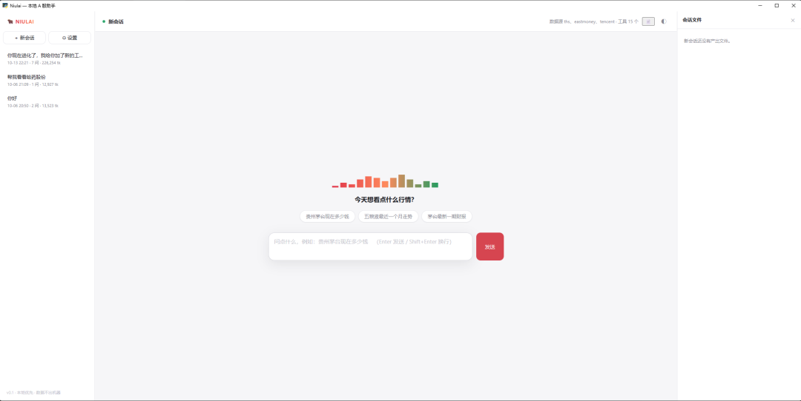

# Niulai

**本地优先的 A 股 AI 助手：装完就能用，自带 API Key，对话和数据全部留在你的电脑里。**

[English](#english)

> 状态：功能已可用，尚未发布到 PyPI（目前从源码安装）。多轮会话、Web 界面、报告生成
> 已跑通；桌面壳已就位，安装包打包中。

---

## 快速开始

需要 Python 3.11+。

### 桌面壳（推荐）

```bash
git clone https://github.com/<you>/niulai.git && cd niulai

# Windows
python -m venv .venv && .venv\Scripts\activate
# macOS / Linux
python -m venv .venv && source .venv/bin/activate

pip install -e "packages/niulai[web,desktop]"
python apps/desktop/main.py          # 弹出原生窗口，就是下面这个界面
```



窗口里能做的事：

- 三栏布局：会话列表 / 对话流（每次工具调用实时可见）/ 右侧会话文件面板；
- ⚙ 设置里直接填 API Key 和同花顺 Key，不用碰环境变量；
- agent 要写你电脑的文件时弹审批框：允许 / 本会话总是允许 / 拒绝；
- 断线或崩溃后，界面提示"恢复现场"，从中断点接着跑；
- 浅色 / 深色 / 跟随系统主题；
- 只绑 127.0.0.1，API Key 不经 HTTP 传输。

不想装桌面依赖，用浏览器标签页也可以：

```bash
pip install -e "packages/niulai[web]"
niulai serve                        # 浏览器打开 http://127.0.0.1:8710
```

### 命令行

安装同第一步（纯 CLI 用 `pip install -e packages/niulai`，不带额外依赖），
配好 Key 就能问：

```bash
# 配置模型（默认推荐国内可直连的 DeepSeek）
export NIULAI_API_KEY="sk-..."
export NIULAI_MODEL="deepseek-flash"                     # 可选（默认值）
export NIULAI_BASE_URL="https://api.deepseek.com/v1"     # 可选
export NIULAI_THS_API_KEY="sk-fuyao-..."                 # 可选：同花顺数据源 Key，缺省退回东财
# 同花顺 Key 申请：登录 https://fuyao.aicubes.cn/admin/ → API Key 管理 → 创建
# 热榜 / 涨跌停池 / 龙虎榜 / 估值 / 异动等市场数据依赖它；也可以在 Web 界面的设置里填

niulai ask "茅台现在多少钱"        # 问一次
niulai chat                        # 或者进入多轮对话（会记住上下文）
```

多轮里可以说"它今天成交多少"——上一轮查的是哪只股票，它记得：

```
你 › 茅台现在多少钱
  ⚙ stock_quote({"symbol":"茅台"})
  ✓ 返回 118 字符
贵州茅台最新价 1253.80 元，涨 0.10%
· 正常结束　2 轮　tokens 1,284

你 › 它最近半年走势怎么样
  ⚙ stock_kline({"symbol":"600519","limit":150})
  📄 结果过大已落盘：.../stock_kline-1e13dcbe.txt（11,240 字符，可用 read_file 读取）
  ⚙ read_file({"path":"...","limit":8})
```

> 加 `--session` 可以把 `ask` 也存成会话：`niulai ask "它业绩怎么样" --session latest`。

想换成 Claude 就改一下协议，接入点和模型会自动跟着换：

```bash
export NIULAI_API_KEY="sk-ant-..."
export NIULAI_PROTOCOL="anthropic"
```

支持的模型：**DeepSeek / 通义 / 混元 / Kimi / OpenAI**（OpenAI 兼容协议）、
**Claude 系**（Anthropic Messages 协议）。

Windows PowerShell 用 `$env:NIULAI_API_KEY="sk-..."`。

> PyPI 发布后，上面这些会简化成一行：`uvx niulai ask "茅台现在多少钱"`。

### 其他命令

```bash
niulai serve                       # 启动本地 Web 界面（默认 http://127.0.0.1:8710）
niulai chat --resume               # 续接最近的会话
niulai chat --resume <session_id>  # 续接指定会话
niulai sessions                    # 列出历史会话
niulai ask "..." --json            # 每行输出一个事件 JSON，便于管道处理
niulai replay latest               # 回放最近一次运行的完整轨迹
niulai resume latest               # 从被中断的 run 恢复出可续聊的会话
niulai tools                       # 列出工具、数据源与各自的能力声明
```

### 配置与数据目录

一切程序生成的文件都在 `~/.niulai/`（Windows 为 `C:\Users\你\.niulai\`），
可用 `NIULAI_HOME` 整体覆盖，删掉它 = 完全重置：

```
~/.niulai/
├─ config.toml   用户配置（唯一需要人动手的文件，可省略）
├─ traces/       每次运行一个 JSONL（每一步都记，可回放）
├─ niulai.db     会话（SQLite 单文件）
├─ artifacts/    因体积过大而落盘的工具结果
└─ logs/         调试日志（DEBUG/INFO 时自动出现）
```

config.toml 示例（只写想改的，其余用默认值）：

```toml
[llm]
# protocol = "openai"          # openai（DeepSeek/通义/Kimi）或 anthropic（Claude）
# base_url = "https://api.deepseek.com/v1"
# api_key = "sk-..."           # 也可用环境变量 NIULAI_API_KEY（优先）
model = "deepseek-flash"
max_turns = 12                  # 单次提问最多几轮工具循环

[datasource]
# ths_api_key = "sk-fuyao-..."  # 同花顺数据源 Key；也可用环境变量 NIULAI_THS_API_KEY（优先）

[log]
# level = "debug"               # 等价于环境变量 NIULAI_LOG_LEVEL
```

优先级：**CLI 参数 > 环境变量 > config.toml > 默认值**。
API Key 可以写进 config.toml（本地单机：文件就在你自己的机器上，不出本机，
界面与日志里只脱敏展示尾号）；环境变量优先于文件。

### 调试日志

trace 记的是运行轨迹；HTTP 层的细节（每次请求、重试、错误响应体）走标准 logging，
只写 stderr（`--json` 的 stdout 事件流不受影响），默认关闭：

```bash
# PowerShell
$env:NIULAI_LOG_LEVEL="DEBUG"      # debug / info / warning / error，默认 warning
$env:NIULAI_LOG_FILE="d:\tmp\niulai.log"   # 可选：不设且级别开到 INFO/DEBUG 时自动落 ~/.niulai/logs/
```

---

## 能力

| 能力 | 状态 |
| --- | --- |
| ReAct 内核（轮数上限 / 工具超时 / 随时取消 / 运行时熔断） | ✅ |
| 流式输出 | ✅ |
| 工具参数校验与结构化错误反馈（参数不对模型能自己改对） | ✅ |
| OpenAI 兼容 / Anthropic Messages 两套协议 | ✅ |
| 重试与错误分类（可重试 / 终止，指数退避加抖动） | ✅ |
| Anthropic 提示缓存（降低输入费用） | ✅ |
| 多轮会话（历史持久化，可续接、可恢复） | ✅ |
| 单标的工具：行情 / K 线 / 财务 / 估值 / 当日异动 / 资金流 / 集合竞价 | ✅ |
| 技术指标：均线 / MACD / KDJ / RSI / 布林带 / 量能 / 金叉死叉 | ✅ |
| 多视角分析（短线情绪 / 中期技术 / 长期价值，观点必带数据与反方证据） | ✅ |
| 市场视野：热股榜 / 飙升榜 / 涨跌停池 / 连板天梯 / 龙虎榜 / 指数与板块 | ✅ |
| 盘前信号：集合竞价快照 / 短线风向标竞价基准 | ✅ 需 `NIULAI_THS_API_KEY` |
| 大结果落盘，只把摘要 + 路径送进上下文，配 `read_file` 分页读 | ✅ |
| 上下文压缩（历史工具结果自动换成占位说明） | ✅ |
| 运行时熔断（重复调用 / 连续失败自动拦下） | ✅ |
| 权限引擎（写文件按路径判定；覆盖 / 越目录先征询用户，数据目录外拒绝；会话级"总是允许"） | ✅ |
| 报告生成（一句话委派报告子代理，主对话只收回路径与小结） | ✅ |
| 被中断的对话可修复（从中断点续跑） | ✅ |
| 数据源限流自动重试 | ✅ |
| 会话存储 SQLite（单文件 `niulai.db`） | ✅ |
| Token 统计（每轮 / 累计） | ✅ |
| 同花顺官方 API 主源（行情 / K 线 / 财务 / 估值 / 热榜 / 涨跌停 / 龙虎榜 / 异动 / 集合竞价 / 指数板块） | ✅ 需 `NIULAI_THS_API_KEY` |
| 东财 / 腾讯兜底（资金流 + 行情降级） | ✅ |
| 本地 Web 界面（三栏 + 右侧会话文件面板） | ✅ |
| 桌面安装包（双击即用） | ⏳ 壳已就位，打包中 |
| 自选股 / 条件预警 / 盘后复盘 | ⏳ |
| 任务级评测集（10 条确定性断言） | ✅ |
| 独立 MCP server（给 Claude Code / Cursor 用） | ⏳ |

---

## 免责声明

⚠️ **本项目仅用于学习与研究。**

- 股票数据来自公开网络接口的抓取，**版权归原平台所有**，请勿用于商业用途。
- 请自行控制请求频率，不要对数据源造成压力。
- **本项目不构成任何投资建议。** 据此操作，风险自负。

## License

MIT

---

<a name="english"></a>

## English

**Niulai** is a local-first AI assistant for China A-share investing. No account, no server,
no data upload — your API key, your conversations and your data stay on your own machine.

```bash
pip install -e packages/niulai
niulai ask "How much is Moutai trading at?"
niulai chat                 # multi-turn conversation with persistent history
niulai serve                # local Web UI at http://127.0.0.1:8710
```

Current capabilities: a ReAct loop with turn / timeout / cancellation budgets, quote /
K-line / financial / valuation / anomaly / money-flow tools, technical indicators
(MA / MACD / KDJ / RSI / Bollinger / volume), market-wide boards (hot list, limit-up
pool, dragon-tiger, index), oversized results written to disk with a `read_file` tool
to page them back, context trimming, a runtime circuit breaker, a permission engine
for file writes, a report sub-agent, SQLite-backed multi-turn sessions with
interrupted-run recovery, and a local Web UI.
