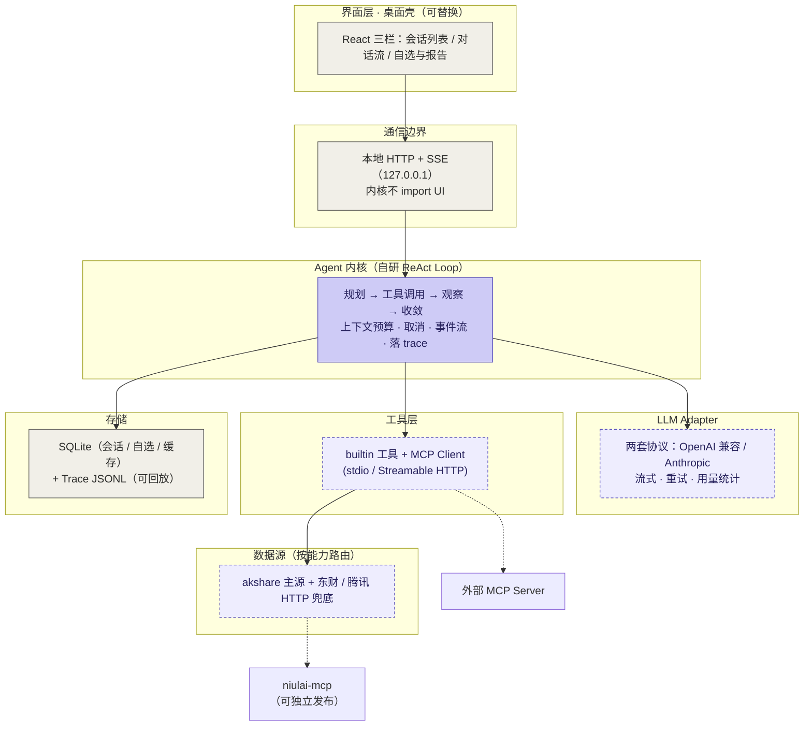
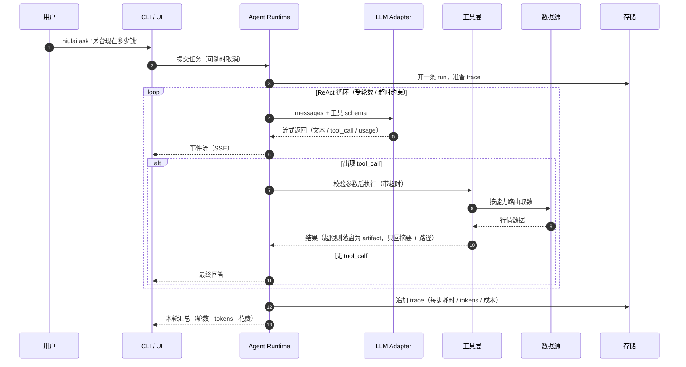

# Niulai 架构设计与实现方案

> 状态：定稿（v1.4）
> 最后更新：2026-10-06
> 本文档是项目的唯一权威设计文档。README 只负责首页展示（定位 + 演示 + 快速上手）。
> 实现进度见 §8 路线图里的 ✅ 标记 —— **标记只代表"有代码且有测试"，不代表"做完了"。**
> 相关：[缺口对照](gap-review.md)（评审结论，非设计文档）

---

## 1. 一句话定位

**Niulai 是一个本地优先的 A 股 AI 助手：安装即用、自带 API Key、对话与数据全部留在本机，远端不存任何用户数据。**

它不是"又一个通用 Agent 框架"，而是**把股票分析这个场景做深的本地 Agent**。这个定位决定了后面所有取舍。

---

## 2. 目标与优先级

三个目标，按权重排序（权重决定架构选择，不是愿望清单）：

| 优先级 | 目标 | 对架构的硬约束 |
| --- | --- | --- |
| P0 | **学习主流 Agent 开发，为跳槽积累** | 必须用主流栈（Python + ReAct 手写内核 + LangGraph + MCP）；必须有 eval 与可观测性 |
| P1 | **自己用，辅助炒股** | 数据源可靠可换；本地持久化；需要常驻/调度（自选股、预警、盘后复盘） |
| P2 | **开源发布，吸引关注** | 安装摩擦要低；无 Key 也能体验；README 首屏要能打动人 |

**若三者冲突，优先级高的赢。** 例如：为了"更好看的桌面体验"而牺牲"内核可讲清楚"，不划算。

---

## 3. 技术选型

| 维度 | 选择 | 理由 | 已知代价 |
| --- | --- | --- | --- |
| 语言 | **Python** | 国内 Agent 岗 JD 统一要求「Python 必精通」；LangChain / LangGraph 是简历核心关键词；akshare 原生 | 桌面打包比 Node 痛 |
| Agent 框架 | **先手写 ReAct 内核，后补 LangGraph** | 主流共识：框架熟练度 < 理解 loop / memory / tool design；手写才能讲清楚每个决策 | 需要自己实现预算、截断、重试 |
| 桌面形态 | **本地 HTTP + SSE + React**，壳最后套 | 开发期零摩擦；前端代码在 Web 阶段沉淀，套壳只是机械劳动 | 需要单独解决打包 |
| 桌面壳 | **PyWebView 优先**，Tauri sidecar 备选 | PyWebView 是纯 Python、单语言；Tauri 体积更小但要碰 Rust | PyWebView 无官方自动更新 |
| 存储 | **SQLite + JSONL trace** | 单文件、零运维；trace 用 JSONL 便于追加与回放 | 无并发写入能力（本地单用户够用） |
| 数据源 | **akshare 主 + 东财 / 腾讯 HTTP 兜底** | akshare 覆盖广；纯 HTTP 分支轻量、无 pandas 依赖 | 两者都是非官方接口，需控频 |
| 包管理 | **uv**（workspace） | 快；自带 Python 版本管理，`uvx` 等价 npx | 生态较新 |
| API Key | **系统凭据管理器**（keyring） | Windows Credential Manager / macOS Keychain | 各平台需分别验证 |
| 依赖分发 | **PyPI + GitHub Releases** | PyPI 给开发者，Releases 给普通用户 | 双通道维护 |

### 3.1 为什么不是 TS

Node / TS 在**单语言全栈**、**打包分发**、**可视化生态**上确实更强，Claude Code / Gemini CLI / Cursor 都是 TS。但：

1. **报告渲染发生在界面层**，两套方案的界面都是 React，图表都是 JS 画 —— 后端语言只负责喂数据，"报告方便"与内核语言无关。
2. Node 真正的优势（打包、桌面分发）**都在 P6 之后**，不影响最早的 2 个月。
3. 而 Python 的优势（akshare、LangGraph 主线、JD 关键词）**在 P0–P3 就直接起作用**。
4. 这里的双语言**不是痛点**：边界是 HTTP + SSE 的 JSON 协议（不是 FFI），是设计好的稳定契约。

**改判规则**：若优先级从"学主流"转为"做精致的本地产品"，则切**全栈 TS**（不要 Python + TS 混搭，混搭才是最差选项）。

---

## 4. 架构总览



**读图三件事**：

1. **两种语言方案的差异只在内核以下** —— 无论选 Python 还是 TS，界面层与通信边界都一样。真要换语言，动的只有内核、工具、数据源这三层。
2. **内核与 UI 之间只有一条线** —— 本地 HTTP + SSE，内核不知道 UI 存在。CLI、浏览器、桌面壳、MCP server 都是同一个内核的不同外壳。
3. **两条虚线是旁路** —— 可独立交付，不阻塞主线。

---

## 5. 分层说明

| 层 | 职责 | 关键约束 |
| --- | --- | --- |
| **界面层** | 会话列表 / 对话流（含工具调用卡片）/ 自选股与报告 | 不写业务逻辑，只消费事件流 |
| **通信边界** | 本地 HTTP + SSE，只绑定 127.0.0.1 | 内核不 import 任何 UI 代码 |
| **Agent 内核** | ReAct 循环、上下文预算、工具调度、取消、事件流、trace | 唯一的"智能"所在，全部可测试 |
| **LLM Adapter** | **两套协议**（OpenAI 兼容 / Anthropic Messages）统一到一套中间表示；流式、重试、用量统计 | 内核只认 `LLMClient` Protocol；错误分类（可重试 vs 终止），不做无脑降级 |
| **工具层** | `builtin`（进程内函数）+ `mcp`（外部 server），统一 Tool 接口 | 参数校验、超时、截断、**权限判定与审批中断**（见 7.12 / 7.14）都在这一层 |
| **数据源** | 行情 / K 线 / 财务 / 资金流的取数、缓存、限流 | 按 **capability** 路由，工具不认识具体来源 |
| **存储** | 会话、自选股、缓存（SQLite）；**run journal（JSONL，兼作恢复日志，见 7.13）** | Key 不落库 |

---

## 6. 一次调用发生了什么



---

## 7. 关键设计决策

这些是面试里会被追问的点，所以每条都写成"决策 + 为什么 + 替代方案"。

### 7.1 手写 ReAct 内核，而不是直接上 LangGraph

**决策**：P0–P4 全部手写，约 150–300 行 Python。P8 再用 LangGraph 重写一版做对照。

**为什么**：主流口径一致 ——「先用 SDK 直接手写一个 ReAct agent，不上框架。理解 loop，再谈抽象。」判定线是：

| 形态 | 该用什么 |
| --- | --- |
| 1–3 个工具、线性 think-act-observe | 手写 loop（覆盖约 40% 真实 agent） |
| 4–8 节点、有真分支 / 需要断点续跑 / 人工审批 | LangGraph |
| 单次跑几小时 / 50+ 并行分支 | Temporal 类自定义编排 |

**代价**：LangGraph 会隐藏 token 记账（需显式挂 callback），而手写版每一分钱都看得见。

### 7.2 四件套预算：轮数 + 超时 + 取消 + 熔断

上一版设计（AgentForge）踩过的坑：`MAX_ITERATIONS = 100`、无单工具超时、无取消。结果是一个坏工具能把整轮跑废。

**决策**：四者缺一不可，且都是**硬约束**：

- 轮数上限（默认 12）
- 单工具超时
- 取消要真能传到底：靠 `asyncio` 的任务取消（`Task.cancel()` → `CancelledError` 逐层透传），**不要自定义标志位**
- **重复调用熔断**（同工具连续失败、或同参数重复调用）

> **2026-10-05 移除 token 预算**：曾经是第五件。移除的理由：`max_turns` 已经隐式约束了
> 单次运行的 token 上限（有限的 LLM 调用次数 × 每次受上下文窗口限制），
> 再设一道 token 闸门是同一层保护的重复设卡，还与 7.3 的上下文裁剪职责重叠。
> 两处真相不如一处。用量的**统计**照旧（USAGE 事件与 trace），只是不再作为停止条件。

**第 5 条为什么必须落在 runtime**：`system_v1.md` 写了「同一个工具连续失败两次就停下来」，但 loop 根本不计数，**模型也没有可靠的计数器** —— 它看到的是文本，不是变量。让模型执行控制流，等于让它心算。所以：

- 同一工具**连续**失败 N 次（默认 2）→ 停止该工具，回灌一条可恢复指引
- 同一工具**同参数**重复调用（参数指纹 = 键排序后的 JSON）→ 直接拒绝执行
- 计数范围是**本次 run**，不跨 run
- 触发后不抛异常，而是回一条提示：

  > `stock_quote 已连续失败 2 次，本轮不再执行。请改用其他工具，或直接告诉用户你拿不到数据。`

  与 7.4 同一条原则：错误字符串本身就是 prompt。

**一般规律**：凡是「必须每次都成立」的约束，都不能只写在 prompt 里。**prompt 是概率性的，runtime 是确定性的。**

**落地状态**：已实现 —— `agent/guard.py`（守卫，状态属于单次 run，不放在全局注册表里，避免跨 run 污染）+ `agent/loop.py::_run_tools`。

一个容易漏掉的细节：**拦截不能只是"不执行"**。assistant 消息已经声明了 tool_calls，transcript 里必须给每一个 call 一条对应结果，少一条就是协议非法（OpenAI 直接 400）。所以被拦下时照样回灌一条 tool 消息，内容写成"别再试了，改走别的路"。

### 7.3 截断必须发生在"进上下文之前"

**错误做法**：只在推给前端时截断 500 字，全量结果原样进 `messages` —— 上下文会爆炸。

**决策**：所有工具结果在写入 `messages` 之前处理：

1. 小结果 → 原样进
2. 大结果 → **写文件（artifact），只回摘要 + 路径**，模型需要时再用 `read_file` 取
3. 历史上早期的工具结果 → 保留最近 3–5 条原文，其余压缩成摘要

**落地状态**：三条都已实现。

- 第 2 条：`tools/base.py::_prepare_result` → `artifacts.py`（落盘 + 路径围栏）→ `tools/files.py`（`read_file` 分页读回）
- 第 3 条：`context.py::fit_context` —— **只换内容、不删消息**

关于第 2 条，有一处比"优化"更重的判断：**截断是丢数据，落盘是保留数据，两者不是同一个功能的两个阶段。** K 线接上后立刻显形 —— 截断会把尾巴削掉，模型看到的是残数据，**但它不知道缺了什么**，于是给出一个基于不完整数据的结论。这比直接报错糟得多，因为它看起来是对的。

所以摘要里必须显式说明「这是被截断的开头，不代表全部数据」。这句话不是客套，是防止模型把预览当全集。

关于第 3 条，裁剪出来的是**发送视图**，不是新历史：会话里存的始终是完整 transcript，恢复、回放、审计都不丢信息。如果为了省 token 把存储也裁了，那"压缩"就变成了"不可逆的丢数据"。

### 7.4 错误字符串本身就是 prompt

工具报错的内容会进入模型上下文，成为下一轮提示词的一部分。

- ❌ `"数据库连接失败"`
- ✅ `"查询 user_id=42 无结果。换个 user_id 或先确认用户是否存在。"`

**决策**：所有工具错误必须写成**可恢复的指引**，并带 `is_error` 标记。

### 7.5 工具 schema 的质量比换模型更重要

实测案例：同一任务，只重写工具描述与参数名，成功率从 60% → 95%。

**决策**：调优顺序永远是 **工具 schema → prompt → 才轮到换模型**。

### 7.6 工具与数据源分离，按能力路由

工具不认识 akshare / 东财。工具只调 `MarketDataService`：

```python
class MarketDataSource(Protocol):
    id: str
    capabilities: set[Literal["quote", "kline", "financial", "moneyflow", "sector"]]
    async def quote(self, symbol: str) -> Quote: ...
```

Service 按 **capability + 优先级 + 健康度** 选源，失败自动换下一个。换源 = 加一个实现类 + 改配置。

（取消相关的约束见 7.2，不在这一层。）

### 7.7 内核不知道 UI 存在

**决策**：Agent Runtime 模块**禁止 import 任何 UI / Web 框架**。UI 通过事件流订阅。这条约束保证了"一份内核四种外壳"（CLI / 浏览器 / 桌面壳 / MCP server）。

### 7.8 Trace 落盘 + 回放

每次运行的事件流追加到用户数据目录的 JSONL，支持 `niulai replay <runId>`。

一箭三雕：**调试**（不用重跑）、**演示**（无 Key 也能看完整跑一遍）、**面试**（能拿出真实运行记录）。

### 7.9 Prompt 独立成目录并版本化

`agent/prompts/` 下的 prompt 带版本号，便于 eval 对比不同版本的差异。

### 7.10 两套协议，一套中间表示

**决策**：`llm/` 里放两个客户端实现，抽一个 `LLMClient` Protocol。`AgentRuntime` 的签名写的是 `LLMClient`，不是任何具体类 —— 内核**在类型层面**就够不着厂商特性。

对外只暴露一套中间表示（`Message` / `ToolCall` / `ToolSpec` / `Usage` / `LLMResponse`），**序列化代码放在各客户端里，不放回 types**。

为什么不能给 `Message` 挂一个 `to_wire()`？因为 Anthropic 需要**跨消息重组**：

| 差异 | OpenAI 兼容 | Anthropic | 谁消化 |
| --- | --- | --- | --- |
| system 位置 | 普通消息 | **顶层参数** | 客户端 |
| 工具结果 | `role="tool"` 消息 | user 消息里的 `tool_result` 块，**同轮多条必须合并** | 客户端 |
| 工具 schema | `function.parameters` | `input_schema` | 客户端 |
| 流式事件 | 单一 delta 形状 | 带类型事件（`content_block_delta` 等） | 客户端 |
| `max_tokens` | 可选 | **必填** | 客户端（默认 8192） |
| 采样参数 | 可用 | **已废弃**，非默认值直接 400 | 客户端（一个都不传） |
| 私有内容块 | 无 | thinking / redacted_thinking，**必须原样回传** | 内核只搬运 |

最后一行是关键：`Message.raw_blocks` 是留给"模型吐出来、但必须逐字节送回"的不透明块。**内核不解读它，只负责别弄丢**。这一条说白了就是——多协议的差异全部沉在客户端，内核只需要保证搬运不丢件。

三个反直觉的坑，都是实打实会 400 的：

1. **Anthropic 的流式错误是从正常 200 的流里推出来的**，拿不到 HTTP 状态码，得按 `error.type` 自己分类可重试与否。
2. **`input_tokens` 不含缓存命中量**。真实输入 = `input_tokens + cache_creation + cache_read`。漏了会让用量统计低估好几倍。
3. **收口轮那句"请立刻回答"紧跟工具结果**，在 Anthropic 下会形成两条连续 user 消息 —— 非法。所以转换时要按 role 合并。

`max_tokens` 在 Anthropic 上是**包含思考**的预算；8K 是奔着"别在长报告里被截断"去的。

### 7.11 MCP 是工具层的第二个来源，不是替代品

`builtin`（进程内函数）与 `mcp`（外部 server，stdio / Streamable HTTP）统一在同一个 `Tool` 接口下。

**同时把 A 股数据源单独暴露成一个 MCP server**（P9）。它的传播价值可能高于本体：Claude Code / Cursor 装了就能查 A 股，装了立刻有用；而 Niulai 本体是需要理解才欣赏的项目。

A2A（跨 Agent 通信）现阶段不动 —— 单 Agent 场景用不上。

### 7.12 权限控制：工具只声明能力，判定权不在工具手里

P0 全是只读工具（行情查询），没有审批需求。但 `Tool` 协议必须**现在**留位——此时只有 1 个工具，改协议成本最低；等接了 MCP、有了 10 个工具、桌面 UI 写完，再改就要动所有地方。

**为什么这个项目绕不开**：不是"别人有所以我也要有"，而是 niulai 有一条别的 agent 没有的攻击链：

```
行情 / 新闻 / 公告          ← 不可信的外部内容
      ↓ 作为工具结果回灌进上下文
      ↓ 它是数据，但内容里可以夹指令
模型被诱导去调写类工具
      ↓
写文件 / 出站请求（把持仓或 API Key 发出去）
```

关键在第一步：**数据源本身就是内容源。** 读本地代码的 agent 可以信任输入，读公开网页的 agent 必须假设输入是敌意的。再加上 P7 有无人值守的盘后复盘——没人盯着时，权限只能靠**预授权**，弹窗救不了。

**三层模型**：

| 层 | 谁负责 | 内容 |
| --- | --- | --- |
| 能力声明 | 工具（自己声明） | `read` / `write_local` / `network` / `exec` |
| 策略判定 | Registry（**不信任**声明） | 能力 + 具体目标（路径、域名）+ 运行模式 → allow / deny / ask |
| 审批通道 | 外部外壳（事件流） | CLI 弹 y/n、桌面弹窗、定时任务走预授权 |

**六条硬约束**：

1. **工具只声明，不判定。** MCP server 声称"我很安全"不能采信 —— 那等于让被审对象当法官。
2. **默认拒绝，显式放行。** MCP 工具首次出现必须 ask，且要展示它来自哪个 server。
3. **审批是事件，不是同步 if。** 内核发 `permission_request` 事件并 await 答复，四种外壳共用一份内核代码 —— 与 7.7 同一条原则。
4. **粒度不是 allow / deny 二值。** 写文件限在 `~/.niulai/` 之下；出站请求限数据源域名白名单。**没有域名白名单，一个通用的 http 工具就是现成的数据外泄通道。**
5. **不可信内容要打标。** 工具返回的网页 / 新闻 / 公告文本，回灌时标注来源信任级。这属于"进上下文之前"那一步（见 7.3），所以 P2 就该做。
6. **不接交易接口。** 一旦涉及下单，问题就从"能不能写文件"变成"能不能亏钱"，性质完全不同；真要做，必须双重确认 + 单笔限额。

**落地节奏**：P2 只留位（`Tool` 的能力字段 + `permission_request` 事件类型），完整策略引擎跟 P7 的无人值守一起做 —— 因为只有出现定时任务，"预授权"这个概念才会被真正逼出来。

**read_file 的边界与契约演进（2026-09-27）**：两点定案。① **围栏**从 artifacts 子目录放宽为整个数据目录 `~/.niulai/`——trace / 会话 / 日志 / config 全是程序自己生成的文件（Key 不在其中），"读自己家的数据"是工具的本职；`ReadFileTool` 的 `data_root` 是注入点。② **路径契约只有一种规范形式**：相对数据根的路径（引用形如 `artifacts/<run_id>/<文件名>`）。曾经两套形式并存（artifact 引用相对 artifacts 子目录、其他文件相对数据根），工具内部"先试一个再试另一个"的解析链看起来像试错——根因是双根双形式，不是解析顺序。定案：一个根、一种形式，模型照抄系统发的引用即可；绝对路径不用（引用会存进会话 JSON，相对形式在数据目录搬家后依然有效，也不把用户名写进 trace）。`ArtifactStore` 降级为**老引用兼容层**（旧会话存的 `<run_id>/<文件名>` 只有它认得），对模型不可见。**目录之外的任意文件读取不在现在实现**：它是 7.14 审批通道的第一个真实用例（工具发 `permission_request` 事件 → 用户确认/拒绝 → 拒绝转为可恢复的 tool_result 回灌）；当前"目录外 → 如实拒绝"是这条路的占位语义，将来策略引擎接管时同一调用点转成审批事件。

### 7.13 Run 是一台可持久化的状态机（暂停 / 恢复）

**核心判断：HITL 审批和中断恢复是同一个底层能力。**

两者都要求"一次运行能在中途挂起、状态落盘、之后从断点继续"。如果"审批"做成 CLI 里的一个 `input()`、"恢复"做成另一个独立功能，这套机制会被实现两遍 —— 而且第二遍必然推翻第一遍。

所以先把 run 建模成状态机，暂停只是它的一个状态：

```
created ──▶ running ──┬──▶ completed
                      ├──▶ failed
                      ├──▶ cancelled      （用户主动停止，不可恢复）
                      └──▶ suspended ──▶ running
                                reasons:
                                · awaiting_approval   等用户批准高危工具
                                · awaiting_input      agent 主动追问用户
                                · interrupted         进程被杀 / 断电 / 关窗口
```

`suspended` 是**一等状态，不是异常路径**。这一条直接决定它要不要落盘 —— 异常路径可以只活在内存里，一等状态必须持久化。

**挂起时要持久化的东西**（少一样就恢复不了）：

| 项 | 为什么 |
| --- | --- |
| messages 全量 transcript（含 `raw_blocks`） | 不存就接不上；Anthropic 侧直接 400 |
| pending tool call（id / name / args） | 恢复后要知道当时正要干什么 |
| usage 累计 | 不存则恢复后预算重置，成本失控 |
| settings 快照（model / protocol / max_turns） | 恢复时用户可能已改配置，用新配置续跑旧 run 会得到不一致结果 |
| 已产出结果的 artifact 路径 | 摘要里的路径必须仍然有效 |
| 事件 seq 游标 | 恢复后事件流要**接着编号**，UI 才能不去重、不乱序 |

**由此升级一个定位**：P0 的 trace JSONL 从"调试旁路"升级为 **run journal（append-only 运行日志）**，它同时是恢复的数据源。恢复流程 = 先重放已落盘事件让 UI 重建状态，再从断点继续。

也就是说，**trace 不是调试工具，它是恢复日志**。这个定位变化会影响它的字段设计：必须够完整，且要能容忍损坏（进程被杀时最后一行可能只写了一半，读取时要跳过残缺尾行）。

**中断要分清四种** —— 用户口中的"中断重试"其实是四件不同的事：

| 用户说 | 实际是 | 现有状态 |
| --- | --- | --- |
| 网络断了再试一次 | **LLM 调用重试**（同一请求重发） | ✅ 已有，且只在未吐字时重试 |
| 点停止 | **取消**（主动终止，不可恢复） | ⚠️ 内核支持，但 Ctrl-C 还没接到内核 |
| 关窗口 / 断电 / 崩溃 | **恢复**（从持久化点继续） | ❌ 完全没有 |
| 换个问法重来 / 重新生成 | **分叉重放**（从历史某点分出新分支） | ❌ 完全没有 |

最后一行有隐藏的架构代价：**分叉要求 transcript 是树，不是链表。** 现在 `RunResult.messages` 是 `list`，天生线性。要支持"这一轮换个说法重问"，每条消息得带 `parent_id`。这个字段现在加是零成本，将来改要同时动存储、事件流和界面。**建议现在就在 `Message` 上留位，实现推到 P7。**

**幂等：恢复时最容易翻车的地方。**

如果 run 崩在「工具已发出、结果未入账」之间，恢复后这个工具会**再执行一次**。对只读行情无所谓；对写文件、下单就是事故。

两步对策：

1. 每次工具调用在**执行前后各写一条 journal**（`tool_call_started` / `tool_call_finished`）。恢复时遇到有 started 无 finished 的调用 → 结果**未知**，不能盲目重试，只能交给审批或让模型显式处理。
2. 写类工具自带**幂等键**（例如 `write_file` 重复执行是覆盖，不是追加）。

这是"至少一次投递"在 agent 里的翻版 —— 传统后端天天处理，agent 领域少见，**是很好的差异点**。

**落地状态（2026-10-06）**：journal 完整化 + `niulai resume` 已实现 ——
TOOL_RESULT / CIRCUIT_BREAK 事件携带完整结果与 `tool_call_id`（SSE 帧剔除 content，只进 journal）；
`trace.load_transcript()` 按事件顺序重建 transcript（崩溃截断由既有残行容忍逻辑处理），
"有声明无结果"交给既有的 `_repair_transcript` 补「结果未知」—— 幂等判定的两半各就各位。
旧格式 journal（tool_call 缺 id）明确拒绝恢复，不做静默修复。
**暂未做**：usage 跨恢复累计、settings 快照（恢复用当前配置续跑）、run 状态机与
`suspended` 状态、Web 端恢复入口 —— 挂账到 SQLite 迁移与 P7 一起。

### 7.14 审批中断（HITL）的六条语义

7.12 定的是"谁能执行"，这里定的是"需要人点头时，机制具体怎么运转"。六条都是实现时一定会踩的：

1. **审批单位是"一轮里的全部工具调用"，不是单个。** 模型一轮可能并行发 3 个调用，逐个弹窗会把人烦死。打包问一次（"本次将执行以下 3 个操作"），但允许逐个批准 / 拒绝。
2. **拒绝必须转成 tool_result 回灌，而不是终止 run。** 内容写成可恢复的指引（与 7.4 同一条原则）：

   > `用户拒绝了 write_file 调用。请不要再尝试该操作。如果目标能不用写文件达成，请换方案；否则请直接告诉用户需要他手动完成什么。`

   第二句"不要再尝试"**不能省** —— 否则模型会换个参数反复重试，用户就陷入跟它拉锯的地狱。
3. **"总是允许"要能记住，且粒度不能只有工具名。** 键是「工具名 + 参数模式」（例如"允许写入 `~/.niulai/reports/` 下的文件"），作用域分本次 run / 本会话 / 永久。只记工具名等于"允许写任意文件"。
4. **审批必须有超时。** 用户走开或无人值守时不能永久挂着。超时默认**拒绝**（fail-safe），并把这个决定写进 trace。
5. **审批决定是事件，要进 trace。** 否则回放时看不到"用户当时批了什么"，`niulai replay` 就讲不清一个被拒绝的 run 为什么那样收场。
6. **审批必须幂等。** 用户点两次"批准"不能执行两次，靠 `request_id` 去重。

### 7.15 会话（session）与运行（run）是两层，不能合并

7.13 的 `suspended → running` 解决的是**同一条 run 的断点续跑**；它**不解决**"新一轮接着上一轮说话"。这两件事极易被混为一谈，一混就会做出一个既不能恢复、也不能多轮的半成品。

```
session  ← 用户发起，生命周期以天 / 周计，是消息的容器
  ├─ run 1    用户："茅台现在多少钱"
  ├─ run 2    用户："它今天成交呢"        ← "它" 指代 run 1 里的 600519
  ├─ run 3    用户："那五粮液对比一下"
  └─ job 1    盘后复盘（无人发起，不属于任何用户会话）
```

**决策**：

1. **session 拥有 transcript，run 借用它。** 现在 `run()` 自己构造 `messages`（`loop.py:63`），要改成"接收已有 transcript + 追加"。**这恰好和 7.13 需要的"接收已有 transcript"是同一处改动** —— 改一次，多轮与恢复两个能力同时到手。
2. **run 结束时把这一轮的 `tool_call` / `tool_result` 也写进 session**，不只是最终问答。否则下一轮模型看不见自己上一轮查过什么。（AgentForge 正是只记最终 QA，多轮回看时模型完全没有工具记忆。）
3. **裁剪必须按"轮"对齐，不能按"条"。** 按条裁剪会把 `tool_call` 与 `tool_result` 拆散，Anthropic 侧直接 400。
4. **会话边界由用户决定。** 系统不得静默合并两个会话。
5. **定时任务（盘后复盘）不写进用户会话**，否则用户第二天打开会看到一堆自己没说过的话。它属于独立的 job 空间。
6. **跨轮的数据会过期 —— 这是炒股助手特有的坑。** 用户问"它**现在**多少钱"时，上一轮的行情可能是十分钟前的，模型很可能直接复用。策略：工具结果一律带 `as_of` 时间戳；实时类结果（行情、资金流、分时）在跨轮引用时标记为**可能过期**，要求模型重新取数；只有慢变数据（财务、公司资料）才允许跨轮复用。

第 6 条是通用的 agent 教材里没有的：**"现在"这个词在会话里是有时效的**，而金融场景会把这个问题放大到不可忽略。

**落地状态**：第 1–3 条已实现（`loop.py::run(messages=...)` + `session.py` + `context.py`）。

第 1 条值得单独说：`run()` 从"自己构造 messages"改成"接收已有 transcript + 追加"，**一个改动同时买到了多轮会话和断点恢复**，所以恢复能力不用再实现第二遍。顺带落地的还有 `_repair_transcript()` —— 崩溃 / 取消后 transcript 尾部会留下"声明了工具调用但没有结果"的破损状态，两个协议都不收，续跑前必须补齐。

第 4、5 条属于 P7 的调度层。第 6 条（时效）目前只体现在两处：prompt 里的一条规则（`system_v2.md` 规则 4）和 `Quote.as_of` 字段。**这是刻意留的**：真正的时效策略（给跨轮的行情结果打"可能过期"标记、按数据类型设不同的失效窗口）应该和缓存层一起做 —— 现在实现只是一层容易和缓存打架的补丁。

**另一个已落地的推论**：`ToolGuard` 的状态属于**单次 run**，不放在 `ToolRegistry` 里。注册表是长生命周期对象，把调用计数塞进去会跨 run 污染（AgentForge 的模块级单例 dict 就是这个毛病，永不清理）。

---

## 8. 路线图

**总原则**：每一格都建立在"上一步已经能跑"之上。**48 小时内必须跑通 P0，在此之前不改设计文档。**

**当前进度（2026-10-06）**：P0–P2、P3.5、P4 已完成；P1 完成——原计划里的"成本统计（折算成钱）"**砍掉了**：本地自带 Key、按量自付，没有算钱的场景，只保留 token 统计；P5 的 Web 三栏界面与 P6 的 PyWebView 壳已能跑（只差打包流水线，见各行标注）。**有意延后**：P3 的兜底源（腾讯 / 新浪 / akshare）——多源路由框架已就绪，但基础能力（P7 场景）优先于数据源冗余，加源只剩实现类，不急。

两处**有意的偏移**：一是原计划 P4 才做会话，实际提前做了，理由是它和"被中断的 transcript 修复"共用同一个入口；二是兜底源推后（见上）。P3.5（eval）已补上：10 条确定性断言 + 运行器（`evals/`），改 prompt 前后各跑一次。

| 阶段 | 内容 | 验收标准 |
| --- | --- | --- |
| **P0 竖切片** ✅ | `niulai ask "茅台现在多少钱"` → 内核 → 1 个工具 → 流式输出 → trace JSONL | 一条命令跑通全链路，JSONL 里有完整的 LLM / 工具 / 用量记录 |
| **P1 LLM Adapter** ✅ | 流式、取消（**Ctrl-C 要能贯穿到工具层**）、重试（错误分类）、用量（token）统计；OpenAI 兼容 / Anthropic 两套协议。原计划的"成本折算成钱"砍掉：自带 Key 按量自付，无算钱场景 | Ctrl-C 能中断正在跑的工具；429 会退避重试；400 立即失败不重试；每轮打印 tokens |
| **P2 工具系统** ✅ | Tool registry、schema 校验、超时、**重复调用熔断**、大结果 artifact 落盘 + **配套的 `read_file` 工具**（只落盘不给读，数据就进了黑洞）；**协议留位：工具能力字段**（见 7.2 / 7.3 / 7.12） | 故意传错参数能拿到结构化错误并被模型自愈；10 万行结果不炸上下文，且模型能用 `read_file` 把需要的部分取回来；同参数重复调用被拦住 |
| **P3 数据源** ⚠️ 有意延后兜底 | 东财 HTTP（quote / kline / financial，含限流重试）+ capability 路由框架已就绪；腾讯 / 新浪轻量兜底与 akshare adapter **延后**——基础能力优先于数据源冗余，加源只剩实现类 | 把主源手动打断，请求能自动切到兜底源（待兜底源落地后验收） |
| **P3.5 任务级 eval** ✅ | 10 条**确定性断言**（工具选择 / 反向路由 / 拒答边界 / 预算 / 自愈 / 落盘链路）+ 运行器（`evals/`，SKIP 不计入通过率） | 改一版 prompt 跑一次 eval，就能判断是变好还是变坏 |
| **P4 存储与服务** ✅ | SQLite（会话存 `niulai.db`；自选 / 缓存随 P7 加表）+ **run journal 落盘与断点恢复**；FastAPI + SSE，只绑 127.0.0.1 + Host 校验；按会话隔离并发 | 浏览器能实时看到与 CLI 相同的事件流；杀掉进程后能从中断处恢复同一条 run |
| **P5 界面** ✅ | 三栏：会话列表 / 对话流（含工具卡片）/ 恢复提示条（`apps/desktop/web/`，本地 HTTP + SSE） | 能提问、能看工具调用过程、能续接与恢复会话 |
| **P6 桌面壳** ⚠️ 差打包 | PyWebView 壳已就位（Windows WebView2 / macOS WKWebView，`apps/desktop/main.py`）；差 GitHub Actions 三平台安装包 | 下载 → 双击 → 引导填 Key → 可用 |
| **P7 场景** | 报告生成、自选股、盘后自动复盘（调度层）；**权限策略引擎 + 审批交互（含无人值守预授权）；transcript 分叉重放；跨轮数据时效策略**（见 7.12 / 7.14 / 7.15） | 关掉界面，定时任务仍能产出报告；越权调用被拦截并写进 trace；拒绝后模型不会反复重试同一工具 |
| **P8 LangGraph 对照** | LangGraph 版重写，跑**同一组** eval 做对比 | 两个实现跑同一组 eval，结果可对比 |
| **P9 MCP Server** | 把股票数据源抽成 `niulai-mcp` 独立发布 | Claude Code / Cursor 装上就能查 A 股 |

**已做的留位**：`Tool.capabilities`（能力声明）与 `session_id`。这两个不是"先占个字段"——它们在被加进去的同一轮里就有真实用户：`read_file` 只读本地、不联网，与三个行情工具的能力确实不同；`session_id` 因为会话落地而立刻需要写进 trace。

**还没做的留位**：`Message.parent_id`、`permission_request` 事件、run 状态枚举（含 `suspended`）。这些等 P7 的权限引擎一起加 —— 现在加就是空字段，属于"假完备"，跟把自己骗过去只差一步。

---

## 9. 仓库结构

```
niulai/
├─ pyproject.toml            # workspace 根（ruff / pytest 配置也在这）
├─ README.md                 # 首屏：定位 + demo + 30 秒上手（非设计文档）
├─ LICENSE
├─ docs/
│  ├─ architecture.md        # ← 本文档
│  ├─ gap-review.md          # 设计 vs 实现的缺口对照（结论已并入本文档）
│  └─ images/                # 截图与 GIF
├─ packages/
│  ├─ niulai/
│  │  ├─ src/niulai/
│  │  │  ├─ agent/           # 手写 ReAct 内核
│  │  │  │  ├─ loop.py       #   循环、预算、工具回灌、transcript 修复
│  │  │  │  ├─ guard.py      #   运行时熔断（状态属于单次 run）
│  │  │  │  ├─ prompt.py
│  │  │  │  └─ prompts/      #   system_v1.md / system_v2.md（版本化，旧的别删）
│  │  │  ├─ llm/             # 两套协议，一套中间表示
│  │  │  │  ├─ types.py      #   协议无关 IR —— 这里没有任何 to_wire
│  │  │  │  ├─ base.py       #   LLMClient 契约 + 共用重试骨架
│  │  │  │  ├─ sse.py        #   共用 SSE 解析
│  │  │  │  ├─ openai_compat.py
│  │  │  │  └─ anthropic.py
│  │  │  ├─ tools/           # 定义、校验、超时、能力声明
│  │  │  │  ├─ base.py       #   registry + 大结果落盘
│  │  │  │  ├─ stock.py      #   quote / kline / financial
│  │  │  │  └─ files.py      #   read_file（带路径围栏）
│  │  │  ├─ datasource/      # 取数：按能力路由，工具不认识具体源
│  │  │  ├─ artifacts.py     # 大结果落盘 + 安全读回
│  │  │  ├─ session.py       # 会话（多轮历史）持久化（SQLite 单文件 niulai.db）
│  │  │  ├─ context.py       # 上下文裁剪（只换内容，不删消息）
│  │  │  ├─ trace.py         # run journal 与回放
│  │  │  ├─ events.py        # 事件类型 —— 内核与外界唯一的接口
│  │  │  ├─ config.py  errors.py  paths.py
│  │  │  └─ cli.py           # 一个订阅者，不是内核的一部分
│  │  └─ tests/              # 全部无网络，秒级跑完
│  └─ niulai-mcp/            # MCP server（独立 pyproject，可单独发布）
├─ apps/
│  └─ desktop/               # 桌面壳 + React 前端
├─ examples/
│  └─ demo.jsonl             # 录好的一次真实运行（无 Key 可回放）
└─ evals/                    # 任务级断言的回归集
```

目录里的分层是**严格单向**的：`cli → agent → tools → datasource`。两条边界尤其不能破：

- `agent/` 不认识任何 UI（它只发事件）；
- `tools/` 不认识任何具体数据源（它只调 `MarketDataService`）。

这两条是"一份内核四种外壳"能成立的全部前提。测试里有一组专门证明它们没被破（`read_file` 的能力声明不含 `network`、内核只搬 `raw_blocks` 不解读）。

`niulai-mcp` 独立 `pyproject.toml` 的意义：Claude Code / Cursor 用户可以只装它、不装桌面应用。monorepo 不妨碍独立发布；等它有自己的用户量，再用 `git filter-repo` 拆仓（保留历史）。

---

## 10. 分发与首次体验

两条通道，面向两类人：

| | 通道 A · 开发者 | 通道 B · 普通用户 |
| --- | --- | --- |
| 对象 | 会用命令行的人 | 散户 |
| 方式 | 装 uv → `uvx niulai` | GitHub Releases 下载安装包 → 双击 |
| 耗时 | 约 30 秒 | 约 5 分钟 |
| 可用时间 | **P0 之后立刻** | P6 之后 |

`uv` 自带 Python 版本管理，所以 `uvx niulai` 连"先装 Python"都省了 —— 这是 Python 生态里最接近 `npx` 的体验。

### 真正的转化摩擦是 API Key，不是安装

散户卡在"请填入 API Key"。对策：

1. README 提供**一屏截图式的 Key 申请引导**，默认推荐国内模型（DeepSeek / 通义），**不默认 OpenAI**。
2. **`niulai replay demo.jsonl`** —— artifact 里附一次真实运行记录，**不填任何 Key 也能看完整 agent 跑一遍**（每步思考、工具调用、结果、耗时、花费）。README 的 GIF 也用它录。

### README 的分工

- 首屏：一句话定位（本地优先 / 数据不出本机）+ demo GIF + 30 秒上手 + roadmap
- 设计与实现细节 → 本文档
- 免责声明 → 见第 12 节

---

## 11. 明确不做（第一阶段）

| 不做 | 原因 |
| --- | --- |
| 服务端 / 多用户 / 注册登录 | 三个目标没有一个需要它，却带来认证、部署、运维、成本 |
| 多 Agent 编排 | 主流共识：单 Agent 能覆盖绝大多数场景，多 Agent 是特定问题的答案，不是默认架构 |
| 向量库 / RAG | 当前场景是"取实时数据 + 推理"，不是"检索私有语料" |
| Electron | 投入产出比最低，对学习目标零帮助 |
| LangGraph（P8 之前） | 先手写理解原理，再上框架 |

不是永远不做，是**现在做只会拖慢主线**。

---

## 12. 风险与合规

1. **数据接口合规**：东财 / 腾讯 / akshare 的接口抓取属灰色地带。自用无碍，但开源必须在 README 注明：**仅用于学习研究、数据版权归原平台、不得商用、请自行控制请求频率**。
2. **不构成投资建议**：README 与界面都需要免责声明。
3. **API Key 安全**：只进环境变量或本机 `config.toml`（本地单用户，文件不出机器；env 优先），展示一律脱敏（只露尾号），绝不进 trace / 日志 / 会话库。共享或多用户场景再接系统凭据管理器（keyring）。
4. **文档膨胀**：本项目的最大历史风险是"用设计替代实现"。硬约束：**48 小时内跑通 P0，此后每加一个功能都必须让它跑起来。**
5. **双项目并行**：前作 AgentForge（Python / FastAPI 服务端多 Agent）**冻结**，不再推进。简历叙事由两个项目合起来讲。

---

## 13. 待定项

- [ ] 默认推荐哪几家模型（按性价比与国内可直连程度排序）
- [ ] tokenizer 选型（`tiktoken` 还是按模型分流估算）
- [ ] 上下文压缩的触发阈值与摘要策略具体参数
- [ ] 跨轮工具结果的时效策略（行情类结果多久算过期，哪些字段可跨轮复用）
- [ ] 是否引入 Anthropic prompt caching 等价能力
- [ ] 自动更新方案（PyWebView 无官方插件）
